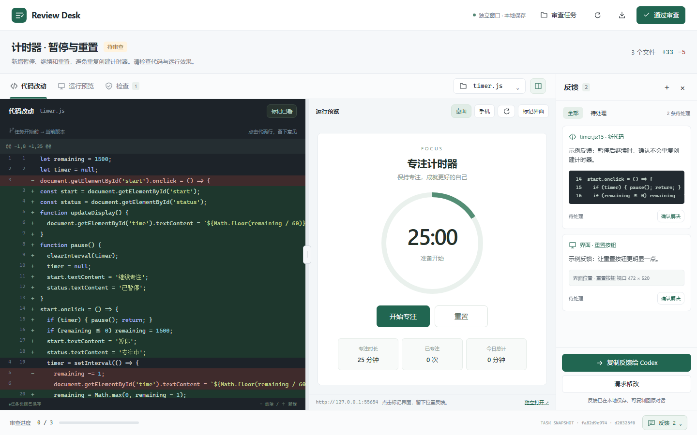
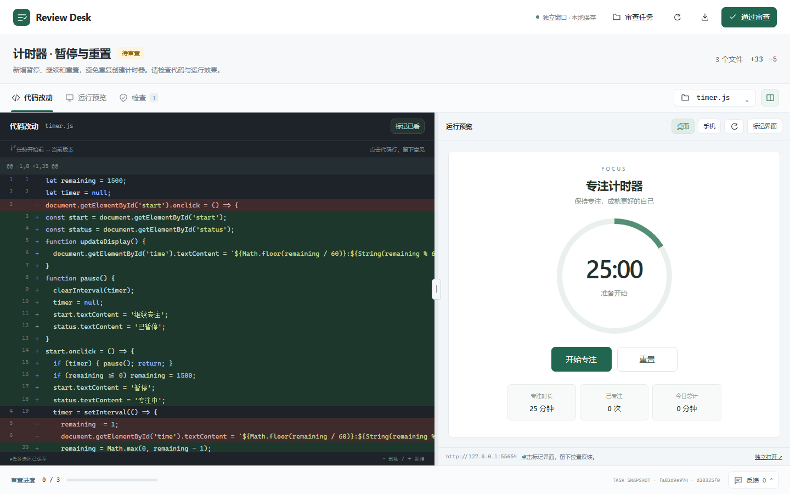

# Review Desk

[English](README.en.md) · [兼容性与验证](docs/COMPATIBILITY.md)

[GitHub 仓库](https://github.com/lcx123-code/review-desk) · [下载 v0.3.0](https://github.com/lcx123-code/review-desk/releases/tag/v0.3.0)

把代码改动、运行效果和你的反馈放在一个审查面板里。为 Codex 本地编码任务设计：修改前保留快照，修改后逐行 review，体验 Web 页面，再把意见交回同一个对话。



## v0.3.0

- 运行服务检查、手动更新地址，以及从项目的明确配置恢复地址。
- 反馈区分已保存、已提交、等待确认和 Codex 已接收；相同意见不会重复发送。
- 审查卡片可展开为 Codex 标签页；缓存的界面模板不会携带其他项目的快照。
- 预览始终提供直接链接和可复制地址，宿主打开请求没有显示页面时也有备用入口。
- MCP 连接变化后，本地备用审查窗口继续运行。

保留原有审查功能：

- 灰白与深绿工作台、深色代码区、语法高亮和审查进度。
- 代码与运行预览并排显示，支持拖动/键盘调整比例；窄窗口切换为单视图。
- 可搜索的文件下拉选择、可收起的反馈栏，以及意见对应的实际代码片段。
- 任务选择器明确显示项目和任务；不会自动选中最近的项目。
- 代码行评论、界面位置反馈、待处理筛选和反馈位置跳转。
- Web 交互预览、桌面/手机宽度切换、检查结果和版本审批。
- 内嵌面板显示连接状态，阻止重复发送；连接失败时保留反馈并提供复制。
- 本地 Python 标准库运行，无 pip 依赖、无 API Key。Node.js 仅用于开发测试。



## 快速试用

需要 Python 3.10+。在仓库根目录运行：

```sh
python plugins/review-desk/scripts/demo.py --workspace demo-work
```

打开终端输出的本地 URL，可以立即查看 diff、体验计时器、添加反馈。Ctrl+C 停止。Windows 也可以运行 `./Start-Demo.ps1`。演示在独立目录创建示例，不修改你的代码项目。

## 安装到 Codex

需要 Git、Python 3.10+ 和支持本地插件的 Codex 客户端。下载并解压发行包，或克隆仓库；在**仓库根目录**注册本地 marketplace：

```sh
codex plugin marketplace add .
```

重启 Codex，在插件目录中选择 **Review Desk 本地插件**，安装 **Review Desk**。在实际代码项目的新对话中运行：

```text
使用 $review-setup 配置当前项目。
```

然后把编码任务交给 Codex：

```text
使用 $review-changes 实现这个功能，写完后让我审查代码和运行效果。
```

支持 MCP Apps 的客户端可渲染对话旁的审查面板。点击审查卡片的展开图标可进入 Codex 标签页；`open_review_panel` 打开任务选择器。固定扩展按钮取决于客户端支持，尚未验证。[兼容性说明](docs/COMPATIBILITY.md) 记录了实机结果和限制。

若系统只有 `python3`，将插件中的 `mcp.json` 和 `.mcp.json` 的 `command` 同时改为 `python3`。自动快照 hooks 是可选项，需在 Codex hook 管理界面审阅并信任；未信任时可以显式使用 `$review-changes`。

## 审查与反馈

Codex 内的运行预览使用单独的浏览器标签页，审查面板保存属于同一任务的界面意见。当前实测客户端会接受「打开运行页面」请求，但没有自动切换到运行页面；可复制面板内的地址，在 Codex 新标签页中粘贴。独立浏览器支持 iframe 预览和位置标记。自动打开的兼容性限制见[实机记录](docs/COMPATIBILITY.md)。

1. Codex 在修改前调用 `begin_review`，保留任务开始时的文件状态。
2. 完成代码和验证后，调用 `refresh_review`、`open_review`。
3. 你查看代码、运行预览、保存评论，点击发送反馈。
4. Codex 读取 `get_feedback` 并调用 `acknowledge_feedback` 确认接收，修复后刷新同一个任务，让你复查。

任务开始前已有的未提交改动保留在基线中。代码版本改变后，旧审批和已看标记会重置；旧评论保留其版本信息。大型、二进制或截断文件不能在面板里记录“完整通过”。

内嵌桥接可用时，反馈提交到当前对话；Codex 正在工作时会进入消息队列。提交成功后，面板会等待代理读取确认，再显示已接收。独立浏览器保存本地反馈，提供复制/导出，需要粘贴回 Codex。Web 预览使用项目自己的开发服务器；插件不会自动执行项目命令。

## CLI 备用入口

所有命令使用同一个数据目录；非 Git 项目在 `begin` 后添加 `--files` 和明确的项目相对路径。

```sh
python plugins/review-desk/scripts/review_desk.py --data-dir ./review-data begin --project /absolute/project/path --title "新增登录页"
python plugins/review-desk/scripts/review_desk.py --data-dir ./review-data refresh SESSION_ID --summary "修改说明" --preview-url http://localhost:5173
python plugins/review-desk/scripts/review_desk.py --data-dir ./review-data open SESSION_ID
python plugins/review-desk/scripts/review_desk.py --data-dir ./review-data feedback SESSION_ID
```

本地面板仅监听 `127.0.0.1`，通过随机 URL 令牌控制访问。快照和意见保存在本机，包含所审查的代码，请不要提交审查数据目录。快照过滤 `.env*`、证书私钥和插件状态等路径，仍应按实际项目选择审查范围。

## 开发

```sh
python plugins/review-desk/tests/test_review_desk.py
cd plugins/review-desk
npm ci
node tests/test_panel.cjs
node node_modules/prettier/bin/prettier.cjs --check web/panel.html tests/test_panel.cjs
```

前端测试会启动隔离的真实本地 API 和模拟 MCP 宿主。如系统命令不同，通过 `REVIEW_DESK_PYTHON` 指定 Python 可执行文件。

打包：`python scripts/package_release.py`，输出版本 ZIP 和 SHA-256 校验文件到 `dist/`。打包器使用文件白名单，排除依赖、审查数据和开发环境文件。

## 许可证

采用 [MIT](LICENSE)。允许使用、修改和商用，分发时需要保留版权及许可证。

接口依据：[本地插件](https://developers.openai.com/plugins/build/plugins)、[MCP App UI](https://developers.openai.com/plugins/build/chatgpt-ui)、[扩展入口](https://developers.openai.com/plugins/build/extensions)。
